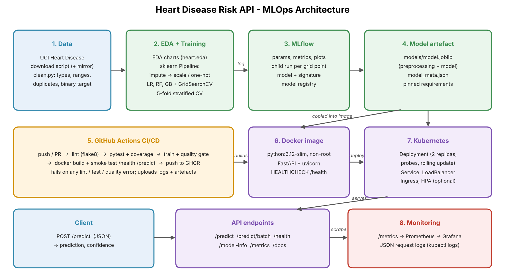

# Heart Disease Risk Prediction — End-to-End MLOps

**Course:** Machine Learning Operations (AIMLCZG523) — Assignment 1
**Author:** Komal Matlawala

A classifier that predicts heart disease risk from 13 patient measurements (UCI Heart Disease, Cleveland data), served as a monitored REST API. The project covers the full path: data download → EDA → training with experiment tracking → tests and CI/CD → Docker → Kubernetes → Prometheus/Grafana monitoring.



## Deliverables (where to find each item)

| Deliverable | Location |
|---|---|
| Code, Dockerfile, requirements | `src/`, `api/`, `Dockerfile`, `requirements.txt`, `requirements-serve.txt` |
| Cleaned dataset + download script | `data/processed/heart_clean.csv`, `src/heart/data.py` (`python -m heart.data`) |
| Notebooks (EDA, training, inference) | `notebooks/01_eda.ipynb`, `02_training.ipynb`, `03_inference.ipynb` |
| Unit tests | `tests/` (21 pytest tests) |
| CI/CD workflow | `.github/workflows/ci.yml` |
| Deployment manifests | `k8s/` (namespace, deployment, LoadBalancer service, ingress, HPA, monitoring) |
| Monitoring config | `monitoring/` (Prometheus + Grafana dashboard), `docker-compose.yml` |
| Screenshots | `screenshots/` |
| Final report | [`report/MLOps_Assignment1_Report.pdf`](report/MLOps_Assignment1_Report.pdf) (also `.docx`) |
| Pipeline video | [`report/MLOps_Assignment1_Pipeline_Final.mp4`](report/MLOps_Assignment1_Pipeline_Final.mp4) (5 min, recorded on the BITS Prayogshala lab VM + GitHub Actions) |
| API access | Local only: see sections 4 (Docker) and 5 (Kubernetes) below |


## Results (held-out test set, 61 patients)

| Model | CV ROC-AUC (5-fold) | Test ROC-AUC | Test accuracy | Test recall |
|---|---|---|---|---|
| **Logistic Regression (selected)** | **0.908 ± 0.018** | **0.960** | 0.869 | 0.929 |
| Random Forest | 0.902 ± 0.022 | 0.955 | 0.869 | 0.929 |
| Gradient Boosting | 0.874 ± 0.028 | 0.946 | 0.885 | 0.929 |

The model is picked by cross-validated ROC-AUC on the training data, not by test score, so the test set stays an honest final check.

## Project structure

```
├── src/heart/            # Python package
│   ├── config.py         # paths, feature lists, valid ranges
│   ├── data.py           # download (UCI + fallback mirror) and cleaning
│   ├── eda.py            # EDA charts -> reports/figures
│   ├── features.py       # sklearn preprocessing pipeline
│   ├── train.py          # GridSearchCV + MLflow tracking + model saving
│   └── predict.py        # load model, predict
├── api/main.py           # FastAPI: /predict, /health, /metrics, ...
├── tests/                # pytest unit tests (data, model, API)
├── notebooks/            # 01_eda, 02_training, 03_inference (executed)
├── data/processed/       # cleaned dataset (raw is re-downloaded)
├── models/               # model.joblib + model_meta.json
├── reports/figures/      # EDA, ROC, confusion matrix, importance plots
├── .github/workflows/    # CI/CD pipeline
├── Dockerfile            # serving image
├── docker-compose.yml    # API + Prometheus + Grafana
├── k8s/                  # namespace, deployment, service, ingress, HPA, monitoring
├── monitoring/           # Prometheus config + Grafana dashboard
├── scripts/              # sample request, traffic generator, diagram
└── screenshots/          # screenshots used in the report
```

## 1. Setup

Requires Python 3.12+ (tested on 3.12 and 3.13).

```bash
git clone <your-repo-url> && cd heart-disease-mlops
python -m venv .venv
source .venv/bin/activate          # Windows: .venv\Scripts\activate
pip install -r requirements.txt
export PYTHONPATH=src:.            # Windows PowerShell: $env:PYTHONPATH="src;."
```

## 2. Run the ML pipeline

```bash
python -m heart.data      # download from UCI (falls back to a mirror) + clean
python -m heart.eda       # charts in reports/figures/
python -m heart.train     # tune 3 models, log to MLflow, save best model
mlflow ui --backend-store-uri sqlite:///mlflow.db --port 5000   # view runs
```

Or simply `make all` (Linux/macOS).

## 3. Test and lint

```bash
flake8 src api tests
python -m pytest -v --cov=src/heart --cov=api
```

## 4. Serve the API

Without Docker: `uvicorn api.main:app --port 8000`, then open http://localhost:8000/docs

With Docker:

```bash
docker build -t heart-disease-api:1.0.0 .
docker run --rm -p 8000:8000 heart-disease-api:1.0.0

curl -X POST http://localhost:8000/predict \
     -H "Content-Type: application/json" -d @scripts/sample_request.json
# {"prediction":0,"label":"no heart disease","probability_disease":0.2009,
#  "confidence":0.7991,"model_version":"1.0.0"}
```

| Endpoint | Purpose |
|---|---|
| `POST /predict` | One patient → prediction, label, probability, confidence |
| `POST /predict/batch` | Up to 100 patients |
| `GET /health` | Liveness / readiness check |
| `GET /model-info` | Loaded model, parameters and metrics |
| `GET /metrics` | Prometheus metrics |
| `GET /docs` | Interactive Swagger UI |

Input fields (UCI codes): `age, sex (0/1), cp (1-4), trestbps, chol, fbs (0/1), restecg (0-2), thalach, exang (0/1), oldpeak, slope (1-3), ca (0-3), thal (3/6/7)`. Out-of-range values return HTTP 422.

## 5. Deploy to Kubernetes (Docker Desktop or Minikube)

```bash
docker build -t heart-disease-api:1.0.0 .
# Minikube only: minikube image load heart-disease-api:1.0.0

kubectl apply -f k8s/00-namespace.yaml -f k8s/01-deployment.yaml -f k8s/02-service.yaml
kubectl -n heart-disease get pods,svc
curl -X POST http://localhost/predict -H "Content-Type: application/json" \
     -d @scripts/sample_request.json
# Minikube: run `minikube tunnel` in another terminal, or use `minikube service heart-api -n heart-disease --url`
```

Optional: `k8s/03-ingress.yaml` (needs an ingress controller) and `k8s/04-hpa.yaml` (needs metrics-server).

## 6. Monitoring

Local stack (API + Prometheus + Grafana):

```bash
docker compose up --build -d
python scripts/send_requests.py --n 200     # generate traffic
```

- Grafana: http://localhost:3000 (admin/admin) → dashboard **Heart Disease API - Monitoring**
- Prometheus: http://localhost:9090
- Request logs (one JSON line per request): `docker compose logs api` or `kubectl -n heart-disease logs -l app=heart-api`

In Kubernetes: create the dashboard ConfigMap, then apply `k8s/05-monitoring.yaml` (commands are at the top of that file) and use `kubectl port-forward svc/grafana 3000:3000 -n heart-disease`.

## 7. CI/CD

`.github/workflows/ci.yml` runs on every push and pull request:

1. **lint** — flake8
2. **test** — pytest with coverage (JUnit + coverage reports uploaded)
3. **train** — download data, EDA, train with MLflow, quality gate (test ROC-AUC ≥ 0.80)
4. **docker** — build image with the new model, start it, call `/health` and `/predict`, upload logs; on `main`, push to GitHub Container Registry

Any failing step stops the pipeline and the logs show why.

## Design decisions

- **One pipeline object** (imputation + scaling + one-hot + model) is saved as a single file, so training and serving can never preprocess differently.
- **Missing values** (`ca`: 4, `thal`: 2) are filled inside the pipeline, not in the CSV, for the same reason.
- **Coded columns** (`cp`, `thal`, `restecg`, `slope`) are one-hot encoded because their numbers are labels, not amounts.
- **Logistic Regression won** on CV ROC-AUC with the lowest variance; it is also easy to explain and tiny to serve.
- **Pinned versions** in both requirement files: the serving image uses the same scikit-learn version that trained the model.
